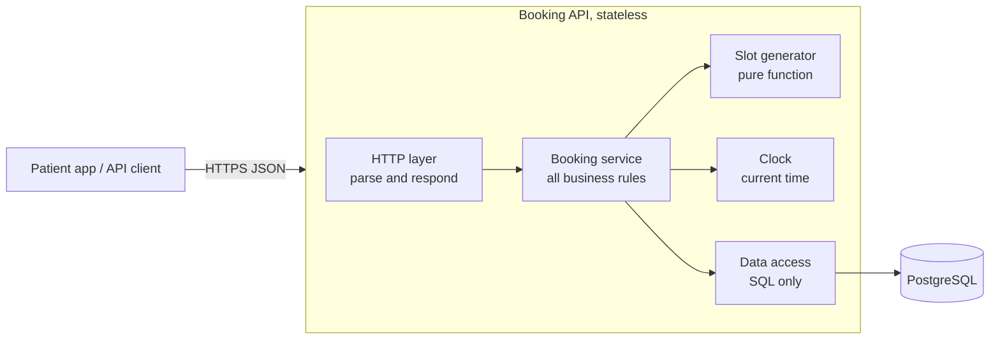
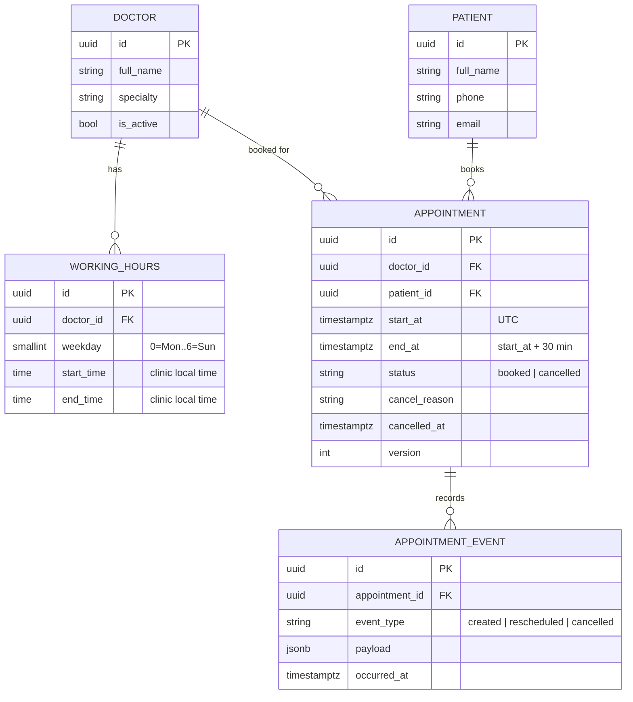
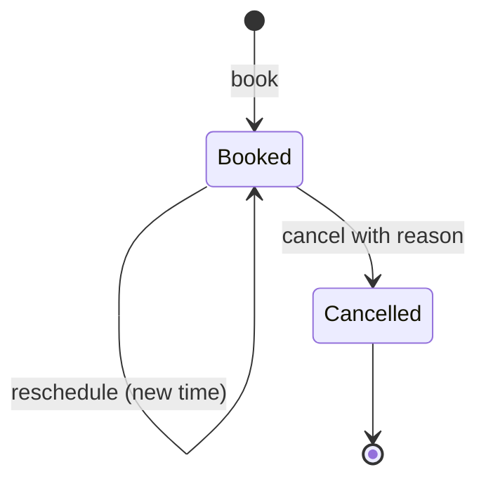
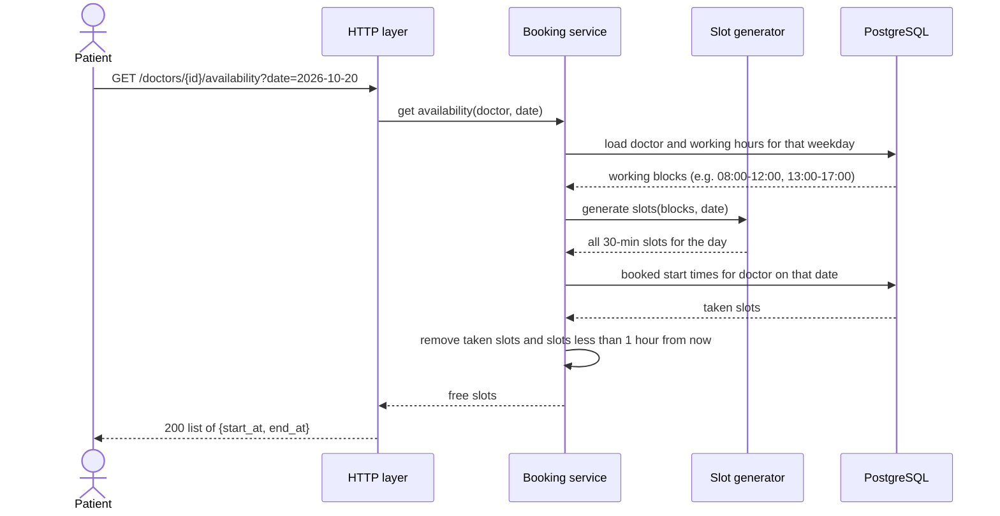
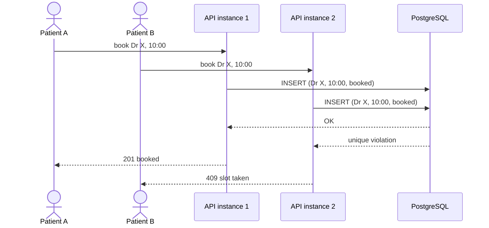

# Clinic Booking API

A REST API for a small clinic: patients see a doctor's free 30-minute slots, book one, cancel with a reason, and reschedule. Built with FastAPI and PostgreSQL, deployed on Render, with tests and auto-deploy in GitHub Actions.

| | |
|---|---|
| Live API | `https://<your-service>.onrender.com` |
| Interactive docs | `https://<your-service>.onrender.com/docs` |
| Health check | `https://<your-service>.onrender.com/health` |

> The free Render instance sleeps when idle. The first request after a quiet period can take up to a minute.

## Contents

1. [Try it in two minutes](#try-it-in-two-minutes)
2. [System design](#system-design)
3. [API reference](#api-reference)
4. [Running locally](#running-locally)
5. [Project structure](#project-structure)
6. [Tests](#tests)
7. [Deployment and CI/CD](#deployment-and-cicd)
8. [Known limitations](#known-limitations)
9. [AI reflection](#ai-reflection)

## Try it in two minutes

The database is seeded with the clinic's 5 doctors (see `migrations/versions/0002_seed_doctors.py`). Dr. Amina Odhiambo has ID `11111111-1111-1111-1111-111111111111` and works Monday to Friday 08:00 to 12:00 and 13:00 to 17:00, plus Saturday mornings.

```bash
BASE=https://<your-service>.onrender.com     # or http://localhost:8000
DOC=11111111-1111-1111-1111-111111111111

# 1. Create a patient
curl -s -X POST $BASE/patients -H "content-type: application/json" \
  -d '{"full_name": "Wanjiku Kamau", "phone": "+254711222333"}'
# copy the "id" from the response
PAT=<patient-id>

# 2. See free slots (pick a future weekday)
curl -s "$BASE/doctors/$DOC/availability?date=2026-10-21"

# 3. Book one
curl -s -X POST $BASE/appointments -H "content-type: application/json" \
  -d "{\"doctor_id\": \"$DOC\", \"patient_id\": \"$PAT\", \"start_at\": \"2026-10-21T09:00:00+03:00\"}"
APPT=<appointment-id>

# 4. Reschedule it
curl -s -X PATCH $BASE/appointments/$APPT/reschedule -H "content-type: application/json" \
  -d '{"start_at": "2026-10-21T14:00:00+03:00"}'

# 5. Cancel it
curl -s -X PATCH $BASE/appointments/$APPT/cancel -H "content-type: application/json" \
  -d '{"reason": "Feeling better"}'

# 6. Upcoming appointments for the patient
curl -s $BASE/patients/$PAT/appointments
```

The `/docs` page lets you do all of this from the browser.

## System design

### Overview

A small clinic with 5 doctors needs online booking. Each doctor works set hours split into 30-minute slots. Patients view free slots for a doctor on a date, book one, cancel, or reschedule. A booked slot must never be given to anyone else.

The system is one stateless API service backed by one PostgreSQL database. The database, not the application, guarantees that a slot can only be held once.

### Components



| Component | Responsibility |
|---|---|
| HTTP layer | Validates request shape, calls the service, maps results and errors to HTTP responses. Holds no business rules. |
| Booking service | Owns every rule: working hours, slot alignment, lead time, state changes for cancel and reschedule. |
| Slot generator | Turns a doctor's working hours and a date into a list of 30-minute slots. No database access. |
| Clock | Supplies "now". Kept separate so time-based rules behave predictably. |
| Data access | The only place that reads and writes the database. |
| PostgreSQL | Stores all data and enforces the no-double-booking rule through constraints. |

### Data model



- **Doctor**: the person whose time is booked. `is_active` hides a doctor without deleting history.
- **WorkingHours**: a doctor's weekly schedule, one row per working block. Two rows on the same weekday model a lunch break.
- **Patient**: the person booking.
- **Appointment**: one patient holding one 30-minute slot with one doctor. Cancelled appointments are kept, not deleted.
- **AppointmentEvent**: append-only history of creation, reschedules (old and new time) and cancellations (reason).

Slots are not stored. A slot is a 30-minute window inside a doctor's working hours, worked out when needed.

#### Constraints that carry the design

```sql
-- One active booking per doctor per slot
CREATE UNIQUE INDEX uq_doctor_active_slot
    ON appointments (doctor_id, start_at) WHERE status = 'booked';

-- A patient cannot hold two appointments at the same time
CREATE UNIQUE INDEX uq_patient_active_slot
    ON appointments (patient_id, start_at) WHERE status = 'booked';
```

Because only `booked` rows are indexed, cancelling an appointment or moving it to another time frees the old slot automatically.

### Appointment lifecycle



Cancelled is final. A cancelled appointment cannot be rescheduled or cancelled again. Past appointments cannot be changed.

### Processes

#### 1. Viewing availability



1. The date is read as a clinic-local date (`Africa/Nairobi`).
2. The doctor's working blocks for that weekday are loaded.
3. Each block is split into 30-minute slots starting at the block's start time. A leftover piece shorter than 30 minutes is not offered.
4. Slots that already have a `booked` appointment are removed.
5. Slots in the past or within 1 hour of now are removed.
6. The remaining slots are returned. A day off or a past date returns an empty list.

#### 2. Booking a slot

```mermaid
sequenceDiagram
    actor P as Patient
    participant API as HTTP layer
    participant S as Booking service
    participant DB as PostgreSQL

    P->>API: POST /appointments {doctor_id, patient_id, start_at}
    API->>S: book(...)
    S->>DB: doctor active? patient exists?
    alt not found
        S-->>API: 404
    end
    S->>S: on a 30-min boundary? at least 1 hour ahead? inside working hours?
    alt rule broken
        S-->>API: 422 with reason
    end
    S->>DB: BEGIN; INSERT appointment (booked); INSERT event (created); COMMIT
    alt unique index violated
        DB-->>S: conflict
        S-->>API: 409 slot taken
    else success
        DB-->>S: saved
        S-->>API: appointment
        API-->>P: 201 created
    end
```

1. Check the doctor exists and is active, and the patient exists.
2. Check the start time sits on a slot boundary.
3. Check it is at least 1 hour from now. This also rules out past times.
4. Convert the start time to clinic local time and check it falls inside one of the doctor's working blocks for that weekday.
5. Insert the appointment and its `created` event in one transaction.
6. If another booking for the same doctor and time already exists, the unique index rejects the insert and the patient gets `409`. If the patient already has an appointment at that time, they also get `409`.

#### 3. Two patients booking the same slot at once



Checking "is it free?" and then inserting is not safe on its own: both requests can see the slot as free. The unique index makes the database the single referee. Exactly one insert succeeds, however many API instances are running.

#### 4. Cancelling

```mermaid
sequenceDiagram
    actor P as Patient
    participant S as Booking service
    participant DB as PostgreSQL

    P->>S: PATCH /appointments/{id}/cancel {reason}
    S->>DB: load appointment
    alt not found
        S-->>P: 404
    else already cancelled
        S-->>P: 409
    else in the past or no reason
        S-->>P: 422
    else
        S->>DB: BEGIN; UPDATE status=cancelled, reason, cancelled_at WHERE version matches; INSERT event; COMMIT
        S-->>P: 200 cancelled
    end
```

1. Load the appointment.
2. Reject if it is already cancelled, in the past, or no reason is given.
3. Set status to `cancelled` with the reason and time, and record the event.
4. The row leaves the unique index, so the slot shows up in availability again straight away.

#### 5. Rescheduling

```mermaid
sequenceDiagram
    actor P as Patient
    participant S as Booking service
    participant DB as PostgreSQL

    P->>S: PATCH /appointments/{id}/reschedule {new_start_at}
    S->>DB: load appointment
    alt cancelled
        S-->>P: 409
    else same slot as now
        S-->>P: 422
    end
    S->>S: run the same checks as a new booking on new_start_at
    S->>DB: BEGIN; UPDATE start_at, end_at WHERE version matches; INSERT event (old, new); COMMIT
    alt new slot taken
        DB-->>S: unique violation, rollback
        S-->>P: 409, original booking unchanged
    else success
        S-->>P: 200 with new time
    end
```

1. Load the appointment. Reject if cancelled or in the past.
2. Reject if the new time equals the current time.
3. Validate the new time with the exact same checks as a fresh booking.
4. Update the same appointment row to the new time in one transaction and record old and new times in the event.
5. The old slot is freed because the row no longer holds that time. The new slot is protected by the same unique index.
6. If the new slot is taken, the transaction rolls back and the patient keeps their original slot.

#### 6. Upcoming appointments for a patient

1. Confirm the patient exists.
2. Return their `booked` appointments with `start_at` after now, sorted soonest first, using an index on `(patient_id, start_at)`.

### Key decisions

| Decision | Reasoning |
|---|---|
| One clinic time zone in config; all times stored in UTC; working hours stored as local times | Doctors think in local time. UTC storage avoids comparison errors. Requests must include a timezone offset. |
| Slots aligned to each working block's start, 30 minutes each | Matches how clinics run. A booking at 09:10 is rejected. |
| Several working blocks per weekday | Allows lunch breaks. |
| Minimum 1 hour lead time | Covers "not in the past" and the bonus rule in one check. Configurable. |
| Patient cannot hold two appointments at the same time | A person cannot be in two rooms. Enforced the same way as doctor double booking. |
| Reschedule updates the existing appointment | Same appointment ID, atomic change, no lost slot on failure. |
| Soft cancellation | Keeps history. The slot is freed by the partial index. |
| `version` column on appointments | Stops two simultaneous edits (cancel and reschedule) from overwriting each other. |
| Availability for a day off or past date returns an empty list | "No free slots" is an answer, not an error. |

### Trade-offs

| Chosen | Alternative | Why |
|---|---|---|
| Compute slots on request | Store a row per slot | No job to generate slots, no stale rows when hours change. About 80 slots per doctor per day is trivial to compute. |
| Unique index in PostgreSQL | Check in code, app locks, Redis lock | Works across any number of instances, cannot be skipped by a code path, adds no infrastructure. |
| Update in place on reschedule | Cancel old and create new | Atomic and keeps a stable ID. History is kept in the event table. |
| One service with clear internal layers | Separate services for booking and availability | One small domain and team. Splitting adds network calls and failure points with no gain now. |
| No cache | Cache availability | The query is small and indexed. A cache could show a slot that was just taken. |
| PostgreSQL | SQLite, MongoDB | Correctness depends on partial unique indexes and transactions. |

### Growth path

Each step adds to the design without replacing it.

1. **Authentication**: patients see and change only their own appointments; staff roles manage all.
2. **More traffic**: run more API instances. The booking guarantee is in the database, so it still holds. Add a connection pooler and read replica later.
3. **Leave and holidays**: a `schedule_exceptions` table that the slot generator applies.
4. **Variable appointment lengths**: replace the unique index with an exclusion constraint on `tstzrange(start_at, end_at)` to reject any overlap.
5. **Multiple clinics**: add `clinic_id` with its own time zone.
6. **Reminders**: write notification events to an outbox table in the booking transaction; a worker sends SMS or email.
7. **Safe retries**: an `Idempotency-Key` on booking so a double tap creates one appointment.

## API reference

### Endpoints

| Method and path | Purpose | Success | Errors |
|---|---|---|---|
| `GET /doctors` | List active doctors and their weekly hours | `200` | |
| `GET /doctors/{id}/availability?date=YYYY-MM-DD` | Free slots for a clinic-local date | `200`, empty list on a day off or past date | `404 DOCTOR_NOT_FOUND`, `422 VALIDATION_ERROR` |
| `POST /patients` | Create a patient | `201` | `422 VALIDATION_ERROR` |
| `POST /appointments` | Book a slot | `201` | `404` doctor or patient, `422 SLOT_MISALIGNED`, `BOOKING_TOO_SOON`, `OUTSIDE_WORKING_HOURS`, `VALIDATION_ERROR`, `409 SLOT_TAKEN`, `PATIENT_DOUBLE_BOOKED` |
| `PATCH /appointments/{id}/cancel` | Cancel with a reason | `200` | `404`, `409 ALREADY_CANCELLED`, `CONCURRENT_MODIFICATION`, `422 APPOINTMENT_IN_PAST`, `VALIDATION_ERROR` |
| `PATCH /appointments/{id}/reschedule` | Move to a new slot | `200` | `404`, `409 APPOINTMENT_CANCELLED`, `SLOT_TAKEN`, `PATIENT_DOUBLE_BOOKED`, `CONCURRENT_MODIFICATION`, `422 SAME_SLOT`, `APPOINTMENT_IN_PAST` and every booking rule |
| `GET /patients/{id}/appointments` | Upcoming booked appointments, soonest first (bonus) | `200` | `404 PATIENT_NOT_FOUND` |
| `GET /health` | Liveness, database check, deployed commit | `200` | `503` if the database is unreachable |

### Status code rules

- `422` means the request breaks a rule and would fail whatever else is happening (bad format, outside hours, too soon).
- `409` means the request is valid but clashes with the current state (slot held, already cancelled, edited by someone else).
- `404` means a referenced record does not exist.

### Error shape

Every error, including request validation, uses one envelope:

```json
{
  "error": {
    "code": "SLOT_TAKEN",
    "message": "That slot is already booked. Please pick another time.",
    "details": { "start_at": "2026-10-21T09:00:00+03:00" }
  }
}
```

`code` is stable and meant for programs. `message` is meant for people.

### Times

Send datetimes in ISO 8601 with an offset (`2026-10-21T09:00:00+03:00` or `2026-10-21T06:00:00Z`). Times without an offset are rejected. Responses always show clinic local time with its offset.

## Running locally

### With Docker (simplest)

```bash
docker compose up --build
```

The API is at http://localhost:8000/docs. Migrations and the doctor seed run on start.

### Without Docker

Needs Python 3.12 and a running PostgreSQL.

```bash
python -m venv .venv && source .venv/bin/activate
pip install -r requirements-dev.txt
cp .env.example .env                  # edit DATABASE_URL if needed
alembic upgrade head
uvicorn app.main:app --reload
```

### Configuration

| Variable | Default | Meaning |
|---|---|---|
| `DATABASE_URL` | local `clinic` database | `postgres://`, `postgresql://` and `postgresql+psycopg://` are all accepted |
| `CLINIC_TIMEZONE` | `Africa/Nairobi` | Zone for working hours and availability dates |
| `SLOT_MINUTES` | `30` | Slot length |
| `MIN_LEAD_MINUTES` | `60` | How far ahead a booking must be |
| `TEST_DATABASE_URL` | local `clinic_test` database | Used only by the test suite |

## Project structure

```
app/
  main.py                 app factory, error handlers, router registration
  core/
    config.py             settings from environment
    clock.py              SystemClock in production, FixedClock in tests
    errors.py             NotFound (404), RuleViolation (422), Conflict (409)
    db.py                 engine and session
  models/                 SQLAlchemy tables, including the partial unique indexes
  schemas/                Pydantic request and response models
  repositories/           all SQL queries
  services/
    slots.py              pure slot arithmetic, no database
    booking.py            every booking rule
  api/                    routers: doctors, patients, appointments, health
migrations/versions/      0001 schema, 0002 seed doctors
tests/
  unit/                   slot generation and slot classification
  integration/            API and service tests on real Postgres
.github/workflows/        CI/CD pipeline
Dockerfile, docker-compose.yml, render.yaml
```

Routers translate HTTP. Services hold the rules and never mention HTTP. Repositories are the only code that writes SQL. The slot generator is a pure function so it can be tested without a database.

## Tests

```bash
docker compose up -d db        # creates clinic and clinic_test databases
pytest -v
```

43 tests cover:

- **Slot arithmetic:** blocks that are and are not multiples of 30, lunch breaks, days off, slots that follow a block starting at :15.
- **Booking rules:** each validation, including the exact 60-minute lead time boundary, offset-less times, UTC input for a local slot.
- **Cancel and reschedule:** slot freed and rebookable, double cancel, reschedule into a taken slot keeps the original, full validation of the new slot, cancelled appointments cannot move.
- **Concurrency:** 10 threads book the same slot at the same moment and exactly one succeeds. A cancel and a reschedule racing on the same appointment: the second writer gets `409 CONCURRENT_MODIFICATION`.

Tests run against real PostgreSQL, built with the real Alembic migrations, not SQLite. The partial unique index is the guarantee being tested, and the migrations get tested on every run as a side effect. The clock is injected so time rules are deterministic.

## Deployment and CI/CD

### Where it runs

Render: one Docker web service and one managed PostgreSQL, defined in `render.yaml`. The container runs `alembic upgrade head` and then starts Uvicorn, so schema changes ship with the code.

### Which branch deploys, and how

`main` is the deployment branch. Merging a pull request into `main` deploys it.

1. A pull request into `main` runs the **Tests** job.
2. Merging the PR creates a push to `main`, which runs **Tests** again on the merged code.
3. If tests pass, the **Deploy** job calls the Render deploy hook.
4. The deploy job then polls `/health` until it reports the merged commit's SHA, so the pipeline only goes green once the new version is actually serving traffic.

Render's own auto-deploy is turned off (`autoDeploy: false`). That way nothing reaches production without passing tests in GitHub Actions first.

### What the pipeline does

`.github/workflows/ci-cd.yml`:

| Job | Runs on | Steps |
|---|---|---|
| Tests | every PR into `main`, every push to `main` | Start a Postgres 16 service container, install dependencies, run `pytest` (migrations included), build the Docker image to catch Dockerfile breakage |
| Deploy | push to `main` only, after Tests pass | Trigger the Render deploy hook, wait until `/health` shows the new commit |

### One-time setup

1. In Render, create a Blueprint from this repository. It creates the database and web service from `render.yaml`.
2. Copy the web service's deploy hook URL (Settings, Deploy Hook).
3. In GitHub, add repository secret `RENDER_DEPLOY_HOOK_URL` with that URL, and repository variable `APP_URL` with the service's public URL.
4. Protect `main`: require a pull request and require the **Tests** check to pass before merging. This is what makes "merged PR" the only way to deploy.

## Known limitations

- **No authentication.** Anyone with an appointment ID can cancel or reschedule it. Adding OIDC/JWT and ownership checks is the first step before real use.
- **No doctor or schedule management endpoints.** Doctors and hours come from the seed migration.
- **No leave or public holidays.** The design's growth path adds a `schedule_exceptions` table.
- **Free hosting tier.** The service sleeps when idle, and the free Render database has a limited lifetime, so it is suited to this assessment, not production.

## AI reflection

See [AI_REFLECTION.md](AI_REFLECTION.md).
